# Numbercraft — Tactile Math & Probability Game Studio

> **Short Description (GitHub):** Tactile math & strategy game studio for ages 8–16 featuring adaptive arithmetic drills, daily streak puzzles, and Factor Grid.
>
> **Short Description (Google Play Store — 78 chars):** Adaptive math games, daily timed puzzles & Factor Grid strategy for ages 8–16.

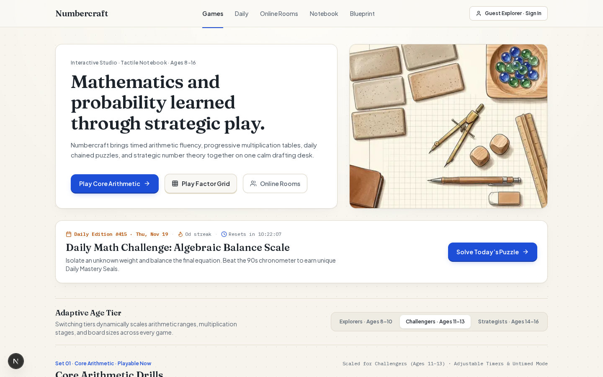

---

## Overview

**Numbercraft** is a Tactile Notebook Studio mathematics, number theory, and strategy web application built for learners aged **8–16** across three adaptive age tiers:

- **Explorers** (Ages 8–10)
- **Challengers** (Ages 11–13)
- **Strategists** (Ages 14–16)

Designed with a warm archival paper grid aesthetic, crisp ink typography, ceramic keypad controls, and non-punitive learning scaffolds, Numbercraft turns daily math practice into a focused, rewarding studio experience.

---

## Core Features

### 1. Core Arithmetic Suite with Adaptive Difficulty Engine
- **Addition Attack:** Timed mental-addition sprints with streak multipliers and regrouping decomposition hints.
- **Subtraction Sprint:** Rapid subtraction practice keeping Explorers/Challengers strictly positive, with optional signed integer differences for Strategists.
- **Multiplication Mastery:** Five-stage progressive multiplication table ladder plus focused table bands.
- **Adaptive Difficulty Engine (Levels 1–5):**
  - Calibrates each session's starting complexity from the student's recent per-game, per-tier history (recency-weighted accuracy, pace, and prior ending band).
  - Dynamically steps up after sustained accurate flow (with anti-oscillation cooldown) and eases down gently after 2 consecutive misses—automatically opening a **Helpful Strategy Cue** mental-math hint so learners stay challenged without getting discouraged.

| Adaptive Setup & Calibration | Live Step-Up & Flow | Gentle Ease-Down + Strategy Cue |
| --- | --- | --- |
| 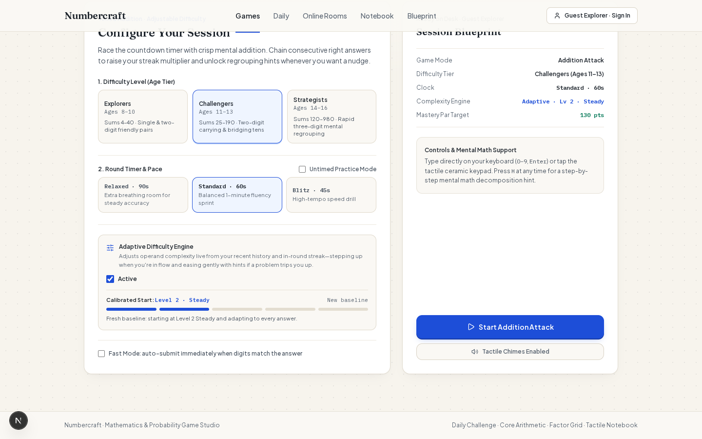 | 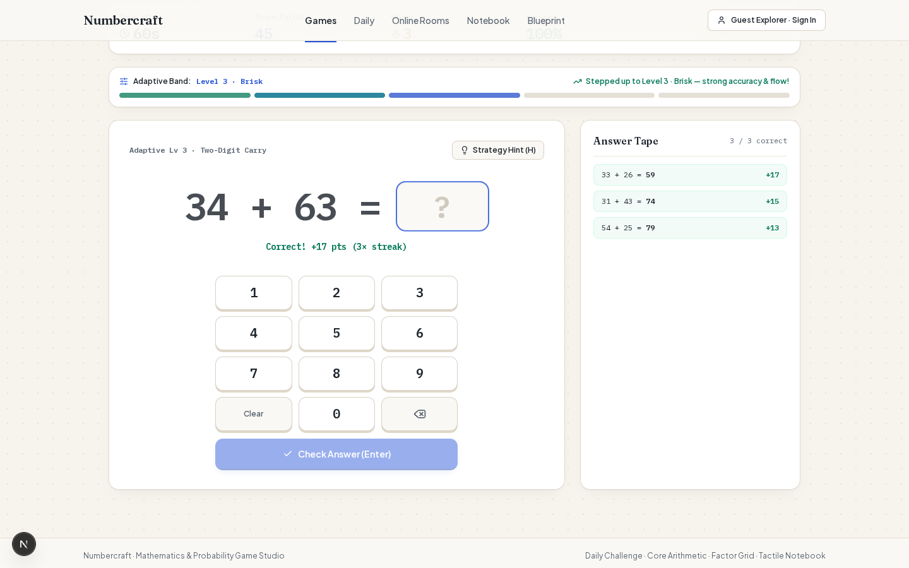 | 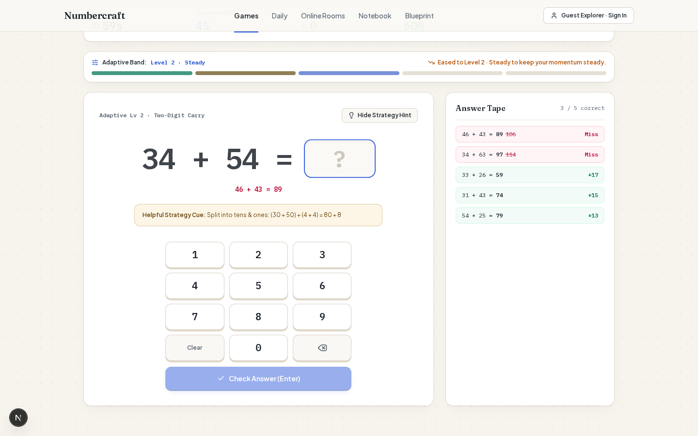 |

---

### 2. Daily Math Challenge, Current Streak & Consecutive Rewards
- **One Unique Timed Puzzle Per Day:** Deterministic calendar-seeded 3-clue linked vaults rotating across four archetypes (*Equation Vault*, *Divisor & Sequence Cipher*, *Algebraic Balance Scale*, and *Mystery Number Deduction*).
- **Current Streak Counter & 7-Day Archival Stamp Strip:** Live midnight countdown clock, dedicated Current Streak panel, and consecutive-day progress tracking.
- **Consecutive Streak Reward Ladder:**
  - **2 Days — Back-to-Back:** `+15 pts` daily score bonus
  - **3 Days — Streak Keeper:** `+30 pts` bonus + **Three-Day Scholar** Mastery Seal
  - **5 Days — Scholar's Flame:** `+50 pts` daily score bonus
  - **7 Days — Weekly Crown:** `+75 pts` full-week score bonus

| Daily Streak Briefing | Timed 3-Clue Vault | Streak Completion & Seal Unlock |
| --- | --- | --- |
| 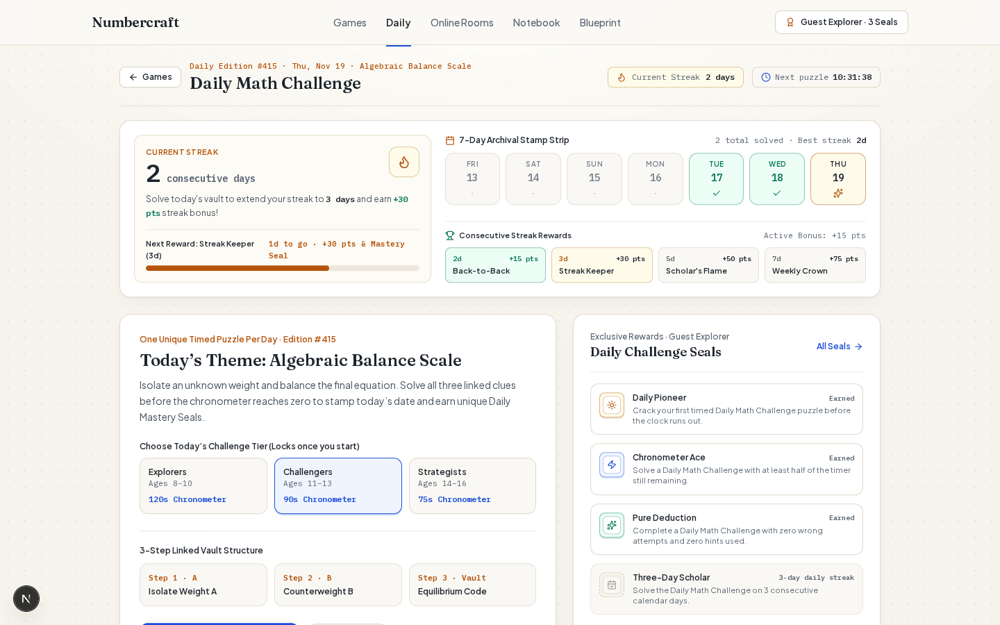 | 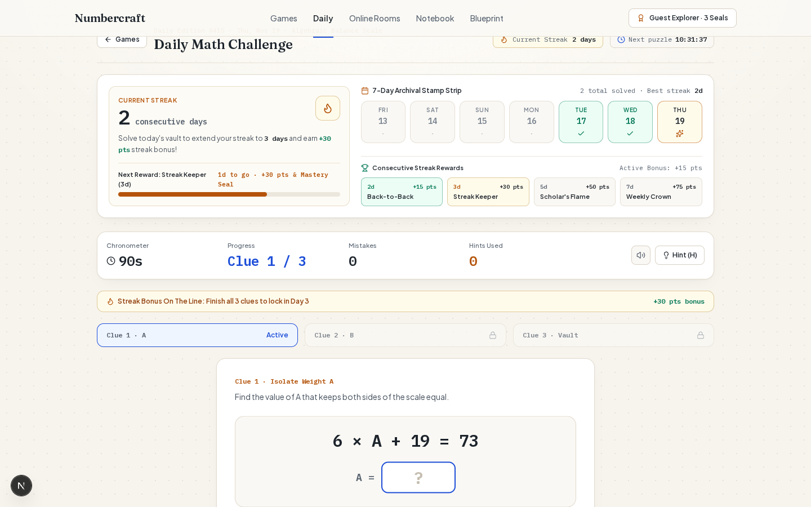 | 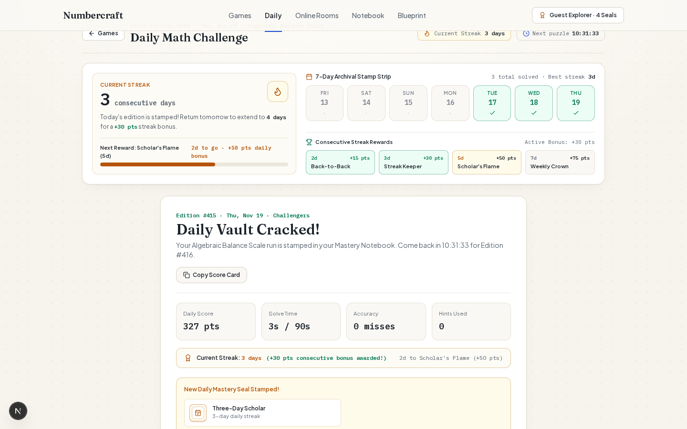 |

---

### 3. Factor Grid (Number Theory Strategy)
- Classic divisor-capture strategy game (*Taxman* mechanics) with **Solo Taxman**, **Human vs. AI** (*Apprentice*, *Scholar*, *Master*), and **Local Pass-and-Play** modes.
- Live move previews exposing proper divisors, net point swings, prime/deficient/perfect/abundant classifications, and optional **Prime Trap** scoring variant.

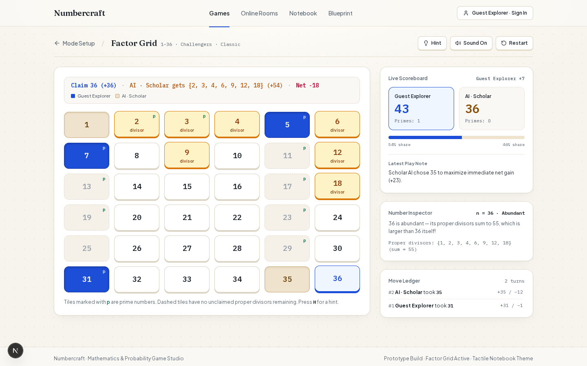

---

### 4. Mastery Notebook, Analytics & 12 Mastery Seals
- Persistent local progress ledger with interactive **Recharts** performance trend charts (score timeline, tier breakdown, mode comparison, and net margin trends).
- **12 Unlockable Mastery Seals** (8 Factor Grid milestones + 4 exclusive Daily Challenge seals) with pin-to-profile indicator in the top navigation bar and account modal.
- **Profile & Account Flow UX:** Interactive sign-in, email/password + Google sign-in prototype, under-13 COPPA guardian consent flow, password recovery, and secure sign-out with shared-device wipe.

| Mastery Seals Showcase | Performance Trends | Profile & Auth Flow |
| --- | --- | --- |
| 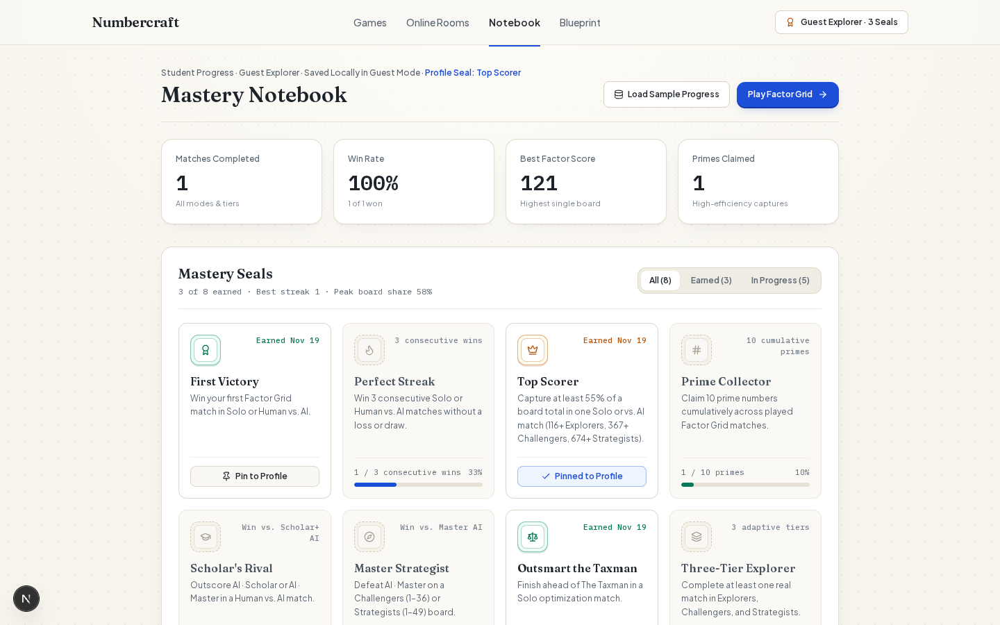 | 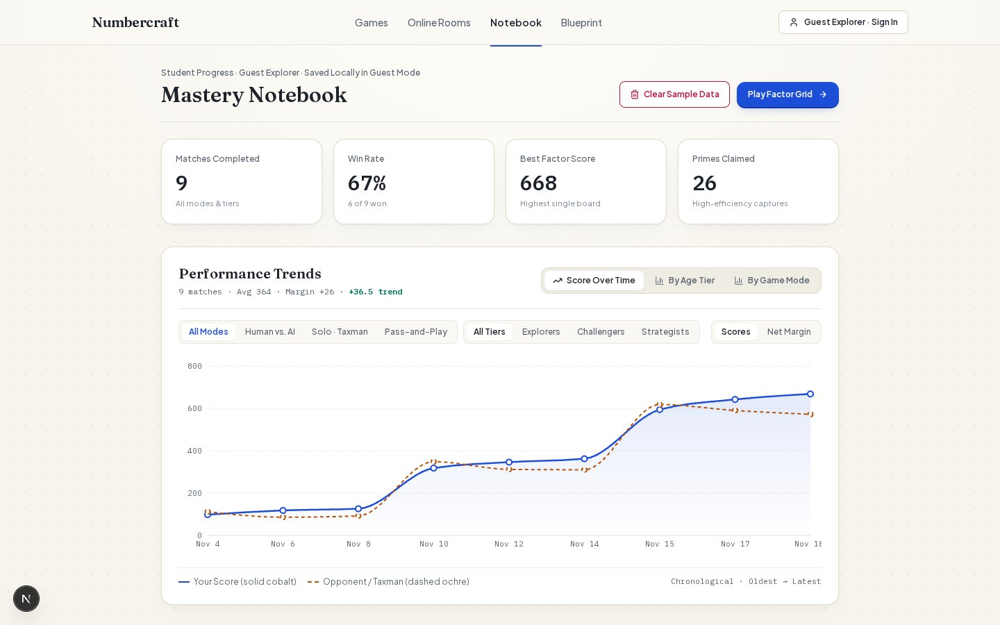 | 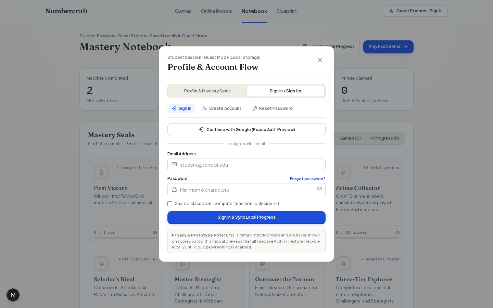 |

---

## Specification Documentation & Design Artifacts

All architecture specs, wireframes, review plans, and authentication UX documentation are included in `/docs`:

- [`docs/SPECIFICATION_AND_WIREFRAMES.md`](docs/SPECIFICATION_AND_WIREFRAMES.md) — Complete Master Product Specification, Game Rules, Pedagogy & Wireframes
- [`docs/specifications/specification_and_wireframes.md`](docs/specifications/specification_and_wireframes.md) — Studio Specification & Screen Architecture
- [`docs/specifications/implementation_plan.md`](docs/specifications/implementation_plan.md) — Technical Implementation Blueprint
- [`docs/specifications/elephant_goldfish_review_and_plan.md`](docs/specifications/elephant_goldfish_review_and_plan.md) — Elephant & Goldfish Iterative Review Plan
- [`docs/specifications/authentication_flow_design.md`](docs/specifications/authentication_flow_design.md) — User Authentication, Privacy, COPPA & Sync Architecture
- [`docs/images/`](docs/images/) — Desktop & Mobile UI Screenshots across all game modes and flows

---

## Tech Stack

- **Framework:** Next.js 15 (App Router) + React 19 + TypeScript
- **Styling & Motion:** Tailwind CSS v4 + `motion/react` + `lucide-react`
- **Charts & Analytics:** Recharts
- **Testing:** Node.js Test Runner (`tsx --test`) + Playwright End-to-End Verification

---

## Local Development & Verification

```bash
# Install dependencies
npm install

# Run development server on port 3000
npm run dev

# Run all 37 unit & integration tests
npx tsx --test \
  lib/factor-grid-engine.test.ts \
  lib/notebook-analytics.test.ts \
  lib/achievements.test.ts \
  lib/app-integration.test.ts \
  lib/arithmetic-engine.test.ts \
  lib/daily-challenge.test.ts \
  lib/adaptive-arithmetic.test.ts

# Run ESLint and Production Build
npm run lint
npm run build
```

---

## Publishing to GitHub

This repository is initialized locally on `main` with all source code, tests, specification documentation, and screenshots committed. To publish to your GitHub repository:

```bash
git remote add origin https://github.com/<your-username>/numbercraft.git
git branch -M main
git push -u origin main
```

Or use the **Save to GitHub** export directly from Google AI Studio.
